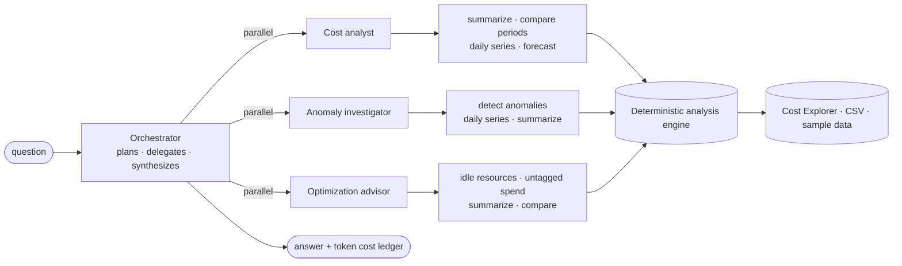

# finops-agent

[](https://github.com/Jebason-Chellakumar/finops-agent/actions/workflows/ci.yml)


A **multi-agent FinOps assistant for AWS costs**, built on Claude. You ask a question in plain English, for example *"Why is our bill up this month and what should we do about it?"* An orchestrator agent then sends specialist agents to investigate in parallel and writes up a short answer an engineering manager can act on.



## Why it's built this way

| Decision | Reason |
|---|---|
| **The models never do the maths.** Every figure comes from a deterministic analysis engine ([`analysis.py`](finops/analysis.py)) exposed as tools | Cost numbers must be auditable. The LLM decides *what to look at* and *explains* it. The tools compute and are unit-tested |
| **Each specialist has its own scoped tool set** | Shorter, sharper prompts and tool lists, so each agent stays on its job. The orchestrator can only delegate |
| **Specialists run in parallel** when the orchestrator delegates to several in one turn | Faster answers. All results return in one message, in call order |
| **Strict tool schemas** (`strict: true`, nullable fields instead of optional ones) | Tool inputs always match the schema. Bad dates etc. come back as `is_error` tool results so the agent can correct itself |
| **Prompt caching** (top-level `cache_control`), a stable system prompt and tools, volatile "today" in the user turn, append-only history | Cache hits on every agent turn after the first |
| **Refusal handling** (`stop_reason` checked before reading content) plus server-side `fallbacks: "default"` | A declined specialist turns into a tool error the orchestrator can work around, instead of a crash |
| **The assistant tracks its own bill.** A token and cost ledger per agent (`--show-usage`) | A FinOps tool should know what it costs to run |
| **A no-LLM path** (`finops report`) | Weekly reports and CI need no API key. The same engine serves both |

## Anomaly detection, briefly

Each series (e.g. *service × team*) is compared with a rolling 14-day baseline. A day opens an anomaly episode when its cost is more than 3 standard deviations above the mean and at least $20 above it. The standard deviation is floored at 10% of the mean so stable series don't alert on noise. While an episode lasts, its baseline stays **frozen**, so a sustained step change keeps being flagged instead of being absorbed into its own baseline. **Hysteresis** keeps a quieter weekend from splitting one incident in two. Grouping by `usage_type` gives the root cause (e.g. `NatGateway-Bytes`).

## Quick start

```bash
python -m venv .venv && source .venv/bin/activate
pip install -e ".[dev]"

# Deterministic report on the built-in sample data (no API key)
finops report

# Ask the agent team (needs ANTHROPIC_API_KEY)
finops ask "Why did our AWS bill go up this month, and what should we do?" --show-usage

# Cheaper specialists, same orchestrator
finops ask "Where can we save money in non-prod?" --worker-model claude-sonnet-5-5
```

The **sample dataset** ([`sample.py`](finops/sample.py)) is 120 days of realistic spend using real Cost Explorer service names. It contains five problems for the agents to find:
1. NAT Gateway data processing for the `search` team that quadruples and keeps going
2. A `g5.2xlarge` GPU instance left running 24/7 in `data-platform` dev
3. A one-day CloudWatch Logs spike in `checkout` prod
4. A staging RDS instance with identical cost every day (idle)
5. About $40/day of EC2 spend with no `team` tag

See what the deterministic engine finds: [`docs/sample-report.md`](docs/sample-report.md).

### Real AWS data

```bash
pip install -e ".[aws]"
finops report --source aws --days 90
finops ask "What changed last week?" --source aws
```

This uses `ce:GetCostAndUsage`, grouped by service and the `team` cost-allocation tag (it must be activated in Billing). Each Cost Explorer request costs $0.01, so data is fetched once per run and analysed locally. You can also analyse any export with the same columns: `--source csv:costs.csv` (run `finops sample` to see the format).

## Project layout

```
finops/
  analysis.py   deterministic engine: summaries, period comparison, anomalies, forecast,
                idle resources, untagged spend
  tools.py      strict JSON-schema tools over the engine
  agents.py     agent loop, orchestrator + specialists, parallel delegation, usage ledger
  sources.py    sample · CSV · AWS Cost Explorer (paginated)
  report.py     Markdown report (no LLM)
  cli.py        finops report | ask | sample
tests/          31 tests: analysis correctness on planted scenarios, agent loop, orchestration
                with a scripted Claude client, Cost Explorer parsing, CLI
```

## Testing without an API key

The agent tests drive the real `Agent`/`FinOpsTeam` code with a scripted fake client. They check request shape (model, effort, caching, strict tools, fallbacks), tool execution and error handling, parallel delegation, refusal handling and usage accounting. The analysis tests check that the engine finds exactly the planted problems, with no false positives in quiet periods.

## License
MIT. Built by [Jebason Chellakumar](https://www.linkedin.com/in/jebason-chellakumar), Cloud Solutions Architect (AWS Certified Solutions Architect – Associate).
